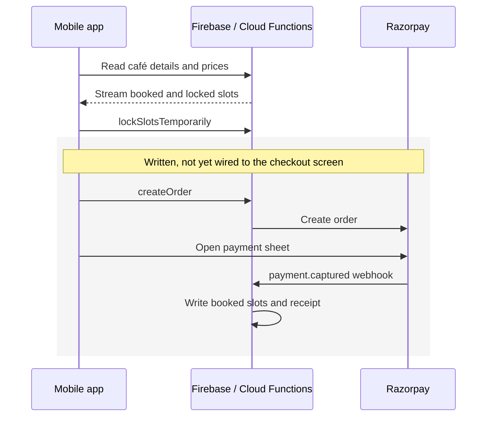

# Kaboom mobile app

The customer booking app for our [Kaboom gaming café](https://github.com/bigtopro/kaboom-cafe). You sign up, pick a café, then choose a game, how many controllers, how long, and a start time on a scrolling time picker that shows which slots are free, live from Firebase.

It's a prototype and never went live; customers at the café didn't book through it. We built it in about two months while new to app development, using FlutterFlow for the screens and custom Flutter/Dart for the time picker, live slot updates, slot locking, and the Razorpay payment actions.

We planned to list every gaming café around our university so people could book any of them from one app, which is why cafés are referenced by ID throughout the data model. We dropped the plan when we closed our location.

## How it works

The time picker maps the scroll position to a time in 15-minute steps. As you scroll, custom widgets find which slot sits under the selection line, and helper functions check it against slots that are booked or locked by someone else's checkout and work out the price.

The payment webhook, booking writes, and discounts live in the backend, in [kaboom-cafe/functions/index.js](https://github.com/bigtopro/kaboom-cafe/blob/main/functions/index.js).

**Where the export stopped.** This is the last FlutterFlow export, from June 2025. The Razorpay actions are written, but the checkout screen is still a placeholder that doesn't call them, and `BOOK NOW` doesn't yet pass the selected time, game, and price to checkout.

## Where to look

Most of `lib/` is generated by FlutterFlow. The code we wrote by hand is three actions, three widgets, and ten helper functions:

| File | What it does |
| --- | --- |
| [realtime_slot_listener.dart](lib/custom_code/widgets/realtime_slot_listener.dart) | Subscribes to live slot availability in Firebase Realtime Database, per café and game type. |
| [vertical_line_tracker.dart](lib/custom_code/widgets/vertical_line_tracker.dart) | Reports where the time picker's selection line sits on screen. |
| [slot_center_detector.dart](lib/custom_code/widgets/slot_center_detector.dart) | Detects which time slot is under that line as you scroll. |
| [custom_functions.dart](lib/flutter_flow/custom_functions.dart) | Generates slots, looks up prices and options, checks for blocked intervals, formats labels, and reads order IDs. |
| [lock_slots.dart](lib/custom_code/actions/lock_slots.dart) | Calls `lockSlotsTemporarily` to hold slots during checkout, with retries. |
| [create_razorpay_order.dart](lib/custom_code/actions/create_razorpay_order.dart) | Sends the amount and booking details to `createOrder`. |
| [process_razorpay_payment.dart](lib/custom_code/actions/process_razorpay_payment.dart) | Opens Razorpay checkout and returns the payment result. |

The screens are in [`lib/pages/`](lib/pages/), and sign-in is in `lib/oauth/`, `lib/log_in/`, `lib/forgot_password/`, and `lib/phone_number_onoarding/`.

## Team and history

This repo is on Venu's account ([@bigtopro](https://github.com/bigtopro), older commits as `BarneyStinson4956`) and holds two FlutterFlow exports, from 26 May and 2 June 2025. Before it we built a plain-Flutter prototype in February 2025 with [@praneeth-gupta](https://github.com/praneeth-gupta), who worked on booking and slot availability there.

## Running it

Flutter stable, Dart `>=3.0.0 <4.0.0` (see [`pubspec.yaml`](pubspec.yaml)). The app needs a Firebase project and the backend from [kaboom-cafe](https://github.com/bigtopro/kaboom-cafe). The checked-in configuration points at our original Firebase project, so it won't run standalone.
